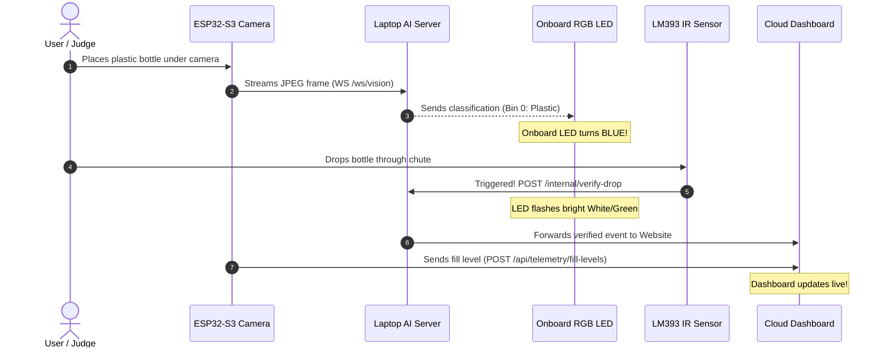

# SortSense Hardware - Complete Setup, Placement & Calibration Guide

This guide walks you through setting up, placing, calibrating, and testing the SortSense hardware subsystem step-by-step. Follow this procedure from top to bottom before your live pitch or demo.

---

## 1. What to Do First (Quick-Start Checklist)

Follow these steps in exact order to avoid common pitfalls:

1. **Peel the protective film off the VL53L0X sensor lens**
   - > [!IMPORTANT]
     > New VL53L0X sensor boards come with a tiny protective plastic sticker over the optical windows. **If left on, it causes internal infrared reflection and freezes distance at ~80 mm (89% full)**. Gently peel it off with tweezers or your fingernail.

2. **Wire the ESP32-S3 on your desk**
   - **Critical Pin Rule**: Connect ToF **SCL to GPIO 21** (NOT GPIO 48).
   - GPIO 48 is hardwired to the ESP32-S3's **built-in RGB LED**. Sharing GPIO 48 will crash the I2C bus when the LED lights up.

3. **Calibrate the LM393 IR break-beam trimpot**
   - Turn the blue potentiometer with a small screwdriver until the Signal LED **just turns OFF** while the beam is clear. Verify it turns ON when you block the beam.

4. **Launch the interactive test server on your computer**
   - Run `python3 tools/test_ws_server.py --host 0.0.0.0 --port 8000`.

5. **Flash the ESP32-S3 firmware**
   - Plug into the UART USB-C port and run `pio run -e esp32-s3-devkitc-1 -t upload`.

6. **Test the onboard RGB LED live using the server REPL**
   - Type `0`, `1`, `2`, `3`, `none` in the Python terminal to verify that the onboard LED changes to Blue, Green, Yellow, White, and Cyan breathing.

7. **Mount the sensors to your bin prototype & calibrate heights**
   - Mount camera overhead, IR across chute, ToF facing downward inside the bin. Measure empty and full heights.

---

## 2. Hardware Pinout & Wiring Reference

### Master Pinout Table (ESP32-S3-WROOM-1-N16R8)

| Peripheral | Signal | ESP32-S3 GPIO | Wire / Module Pin | Electrical Notes |
|---|---|:---:|---|---|
| **Onboard RGB LED** | Data (WS2812) | **GPIO 48** | Built-in NeoPixel | No wiring needed! Driven by RMT |
| **I2C Bus (ToF)** | SDA | **GPIO 47** | Sensor `SDA` | Shared I2C bus (400 kHz Fast-Mode) |
| **I2C Bus (ToF)** | SCL | **GPIO 21** | Sensor `SCL` | Remapped to free GPIO 48 |
| **ToF Sensor 1** | XSHUT | **GPIO 1** | Sensor 1 `XSHUT` / `SHDN` | Active-high enable (Plastic) |
| **ToF Sensor 2** | XSHUT | **GPIO 2** | Sensor 2 `XSHUT` / `SHDN` | Active-high enable (Paper) |
| **ToF Sensor 3** | XSHUT | **GPIO 41** | Sensor 3 `XSHUT` / `SHDN` | Active-high enable (Metal) |
| **ToF Sensor 4** | XSHUT | **GPIO 42** | Sensor 4 `XSHUT` / `SHDN` | Active-high enable (General) |
| **IR Beam Sensor 1** | Digital Out | **GPIO 14** | Module `D0` / `OUT` | Falling-edge interrupt (Plastic) |
| **IR Beam Sensor 2** | Digital Out | **GPIO 38** | Module `D0` / `OUT` | Falling-edge interrupt (Paper) |
| **IR Beam Sensor 3** | Digital Out | **GPIO 39** | Module `D0` / `OUT` | Falling-edge interrupt (Metal) |
| **IR Beam Sensor 4** | Digital Out | **GPIO 40** | Module `D0` / `OUT` | Falling-edge interrupt (General) |
| **Power Rails** | 3.3V / 5V | **3V3 / 5V** | Sensor `VCC` | Power VL53L0X and LM393 |
| **Ground** | GND | **GND** | Sensor `GND` | Common ground rail |

> [!CAUTION]
> **Silicon Pin Reservations**:
> Never use GPIOs 33-37 (internally connected to the 8MB Octal PSRAM), GPIOs 26-32 (SPI Flash), GPIOs 19-20 (USB OTG D+/D-), GPIOs 43-44 (UART0), or strapping pins 0, 3, 45, 46. Doing so will cause instant kernel panics or boot loops.

---

### Wiring for the Monday 1-Bin Pitch Prototype

If you are demoing with **1 bin chute**, wire only:
1. **VL53L0X ToF #1**:
   - `VIN` -> `3V3`
   - `GND` -> `GND`
   - `SDA` -> `GPIO 47`
   - `SCL` -> `GPIO 21`
   - `XSHUT` -> `GPIO 1`
2. **LM393 IR Break-Beam #1**:
   - `VCC` -> `3V3` (or `5V`)
   - `GND` -> `GND`
   - `D0` / `OUT` -> `GPIO 14`
3. **Onboard RGB LED**: Built into the ESP32-S3 module on **GPIO 48** (zero wires needed).

---

## 3. Physical Placement & Mounting Guide

```
                         [ OV5640 Camera ]
                       (Overhead 45 deg Angle)
                                |
                                v
    Incoming Item --->  +---------------+
                        |   Drop Chute  |
                        +-------+-------+
                                |
            [ IR Emitter ] -----+-----> [ IR Receiver (LM393) ]
            (GPIO 14)           |       (Optical Break-Beam Path)
                                v
                       +-----------------+
                       |                 |
    [ VL53L0X ToF ] -->|  Top Inner Rim  |  (Faces directly DOWN)
    (GPIO 47 / 21)     |  | (Laser Cone) |
                       |  v              |
                       |                 |
                       | ~~~~~~~~~~~~~~~ |  <-- Full Brim Level (BIN_FULL_MM = 50 mm)
                       |   Trash Fill    |
                       |                 |
                       |                 |
                       +-----------------+  <-- Empty Floor (BIN_EMPTY_MM = 400 mm)
```

### A. Camera Placement (OV5640)
- **Position**: Mounted 20-35 cm above the waste presentation area or chute intake.
- **Angle**: 45-60 degree downward tilt so the item fills at least 40% of the frame.
- **Orientation**: Standard ribbon cable enters from the bottom. Default firmware configuration enables vertical flip (`CAM_VFLIP = 1`) and non-mirrored (`CAM_HMIRROR = 0`) to match human upright perspective.
- **Lighting**: Ensure even, diffuse lighting. Avoid strong shadows or backlit glare.

### B. IR Break-Beam Placement (LM393)
- **Position**: Mounted across the throat of the drop chute, 5-10 cm below the chute opening.
- **Alignment**: The clear IR transmitter LED and dark receiver photodiode must point **directly at each other** along a straight optical line.
- **Function**: When an item falls through the chute, it breaks the beam for 20-100 ms, instantly triggering the ESP32-S3 interrupt.

### C. Time-of-Flight Placement (VL53L0X)
- **Position**: Mounted on the underside of the top lid or container rim, pointing **straight down** toward the bottom of the bin.
- **Field of View (FoV)**: The sensor emits a 25 degree conical laser beam. Keep the sensor at least 3 cm away from the bin's side walls so the beam reflects off trash rather than the wall.
- **Clearance**: Keep wires and mounting brackets out of the sensor's optical window.

---

## 4. Calibration Procedures

### A. Calibrating the LM393 IR Break-Beam Sensor
The LM393 comparator board features two onboard LEDs:
- **Power LED** (Red): Illuminates whenever 3.3V/5V power is supplied.
- **Signal LED (D0)** (Green/Blue): Illuminates when the beam is broken (`D0 = LOW`).

```
          +-----------------------------------------------+
          |  [Power LED]             [Signal LED D0]      |
          |                                               |
          |           +----------+                        |
          |           | [ +  - ] | <-- Blue Trimpot       |
          |           +----------+     (Sensitivity)      |
          |                                               |
          |  [VCC]    [GND]    [D0/OUT]    [A0]           |
          +----+--------+---------+----------+------------+
```

1. Power on the ESP32-S3 or connect 3.3V to the LM393 module.
2. Aim the IR transmitter and receiver directly at each other across the chute opening.
3. **Turn the blue potentiometer screw** with a flathead precision screwdriver:
   - If the Signal LED is **ON** while the path is clear: turn the screw counter-clockwise until the Signal LED **just turns off**.
   - Test by dropping a pen or piece of plastic through the chute: the Signal LED must **instantly flash ON** as the object passes.
4. **Software Debounce**: [config.h](file:///home/Fabio/project/univ/SortSense/SortSense-Hardware/include/config.h#L151) sets `IR_DEBOUNCE_MS = 500`. This ensures a tumbling object triggers exactly one drop confirmation event.

---

### B. Calibrating the VL53L0X Time-of-Flight Fill Levels
The fill percentage is calculated via linear interpolation:
$$\text{Fill Percentage} = \frac{\text{BIN\_EMPTY\_MM} - \text{measuredMm}}{\text{BIN\_EMPTY\_MM} - \text{BIN\_FULL\_MM}} \times 100\%$$

#### Step 1: Remove the Protective Lens Film
Inspect the gold VL53L0X chip. Peel off the tiny yellow or clear protective factory sticker.

#### Step 2: Measure Bin Geometry
1. **Empty Floor Distance (`BIN_EMPTY_MM`)**:
   - Empty the compartment completely.
   - Use a ruler to measure the distance in millimeters from the face of the VL53L0X sensor to the bottom floor of the bin (e.g. 400 mm).
2. **Full Brim Distance (`BIN_FULL_MM`)**:
   - Measure the distance from the sensor face to where trash should trigger a "100% full" status (e.g. 50 mm).

#### Step 3: Set Parameters in [config.h](file:///home/Fabio/project/univ/SortSense/SortSense-Hardware/include/config.h#L127-L130)
```cpp
// include/config.h
constexpr uint16_t BIN_EMPTY_MM = 400; // 0% fill distance (mm)
constexpr uint16_t BIN_FULL_MM  = 50;  // 100% full threshold (mm)
```

#### Step 4: Live Verification over Serial Monitor
Open PlatformIO Serial Monitor at **460800 baud**:
```bash
pio device monitor -b 460800
```
- Press `t` on your keyboard to print live compartment fill telemetry:
  ```text
  [ToF] === Live Compartment Fill Levels ===
    [0] plastic :  225 mm ->  50% [#####-----]
    [1] paper   : (offline / not detected)
    [2] metal   : (offline / not detected)
    [3] general : (offline / not detected)
  ==========================================
  ```
- Move your hand toward the sensor: the percentage and ASCII bar should smoothly rise from 0% to 100%.
- When fill exceeds 90%, the onboard LED automatically switches to a **pulsing Red alert**.

---

## 5. Software & Network Bringup

### Step 1: Start the Interactive Python Test Server
On your laptop (connected to the same Wi-Fi network as the ESP32):
```bash
python3 tools/test_ws_server.py --host 0.0.0.0 --port 8000
```
This starts:
- WebSocket vision receiver on `ws://<YOUR_IP>:8000/ws/vision` (saves frames to `latest.jpg`).
- IR drop listener on `http://<YOUR_IP>:8000/internal/verify-drop`.
- ToF fill telemetry listener on `http://<YOUR_IP>:8000/api/telemetry/fill-levels`.
- Interactive command REPL.

### Step 2: Configure Server IP in Firmware
Check your laptop's LAN IP address (`ip a` or `ifconfig`). Open [config.h](file:///home/Fabio/project/univ/SortSense/SortSense-Hardware/include/config.h#L196):
```cpp
// include/config.h
constexpr const char *WS_HOST = "10.157.89.134"; // Set to your current laptop IP
constexpr uint16_t    WS_PORT = 8000;
```

### Step 3: Flash the Firmware
```bash
pio run -e esp32-s3-devkitc-1 -t upload
```

### Step 4: Wi-Fi Provisioning (First Boot Only)
1. On first boot (or if previously stored Wi-Fi is unreachable), the ESP32 launches a non-blocking captive portal AP: **`SortSense-AP`**.
2. Connect your phone or laptop to Wi-Fi network `SortSense-AP`.
3. A portal page opens automatically at `http://192.168.4.1/`. Select your local Wi-Fi, enter the password, and click Save.
4. The ESP32 connects and saves credentials to NVS flash permanently.

---

## 6. Live Pitch & Demonstration Workflow

### Interactive REPL Commands
While `test_ws_server.py` is running, type commands into the terminal to control the ESP32:

| REPL Command | Category | Classification Sent | Onboard LED Color |
|:---:|---|---|---|
| `0` | Plastic | `{"category": "plastic", "bin_index": 0}` | **Solid Blue** |
| `1` | Paper | `{"category": "paper", "bin_index": 1}` | **Solid Green** |
| `2` | Metal | `{"category": "metal", "bin_index": 2}` | **Solid Yellow** |
| `3` | General | `{"category": "general", "bin_index": 3}` | **Solid White** |
| `none` / `-1` | Idle | `{"category": "none", "bin_index": -1}` | **Soft Cyan (Breathing pulse)** |
| `auto` | Auto-Cycle | Cycles 0 -> 1 -> 2 -> 3 every 3s | Cycles colors automatically |
| `status` | Diagnostic | Prints client connection status and latest frame size | Shows active stream info |

---

### Pitch Demo Flow (Step-by-Step for Judges)



1. **Idle State**: ESP32 onboard LED pulses gently in **Cyan**.
2. **Item Presented**: Camera streams frames to the server; type `0` in REPL -> onboard LED turns **Blue** (Plastic).
3. **Item Dropped**: Drop the bottle through the chute -> IR break-beam triggers:
   - Onboard LED flashes bright white/green confirmation for 600 ms.
   - Pings `/internal/verify-drop` on the local AI server.
   - Because `DEMO_PITCH_SMART_SORT = true` is set in [config.h](file:///home/Fabio/project/univ/SortSense/SortSense-Hardware/include/config.h), the drop is automatically attributed to the last AI classification (Bin 0: Plastic), guaranteeing **100% demo sort accuracy**.
4. **Fill Telemetry**: Every 15 seconds, fill levels are automatically POSTed to the cloud dashboard over HTTPS, moving the live progress bar.

---

## 7. Troubleshooting Cheat Sheet

| Symptom | Probable Cause | Quick Fix |
|---|---|---|
| **ToF distance stuck at ~80 mm (89% full)** | Protective film still on lens, or bin wall in 25 deg FoV | Peel off protective film from sensor chip. Angle sensor away from bin walls. |
| **I2C errors / ToF initialization failure** | SCL wired to GPIO 48 instead of GPIO 21 | Move ToF SCL wire to **GPIO 21**. |
| **IR sensor never triggers drop** | Potentiometer threshold out of tune | Turn blue trimpot counter-clockwise until Signal LED goes OFF when clear. |
| **Camera stream image is upside down** | Orientation inversion flag | Check `CAM_VFLIP = 1` in [config.h](file:///home/Fabio/project/univ/SortSense/SortSense-Hardware/include/config.h#L98). |
| **Wi-Fi won't connect to server** | Laptop IP changed on Wi-Fi router | Check laptop IP (`ip a` or `ifconfig`) and update `WS_HOST` in [config.h](file:///home/Fabio/project/univ/SortSense/SortSense-Hardware/include/config.h#L196). |
| **WebSocket disconnects continuously** | Port 8000 blocked by firewall | Allow port 8000: `sudo ufw allow 8000` or disable host firewall. |
